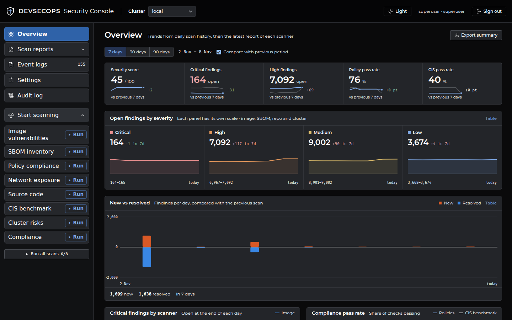
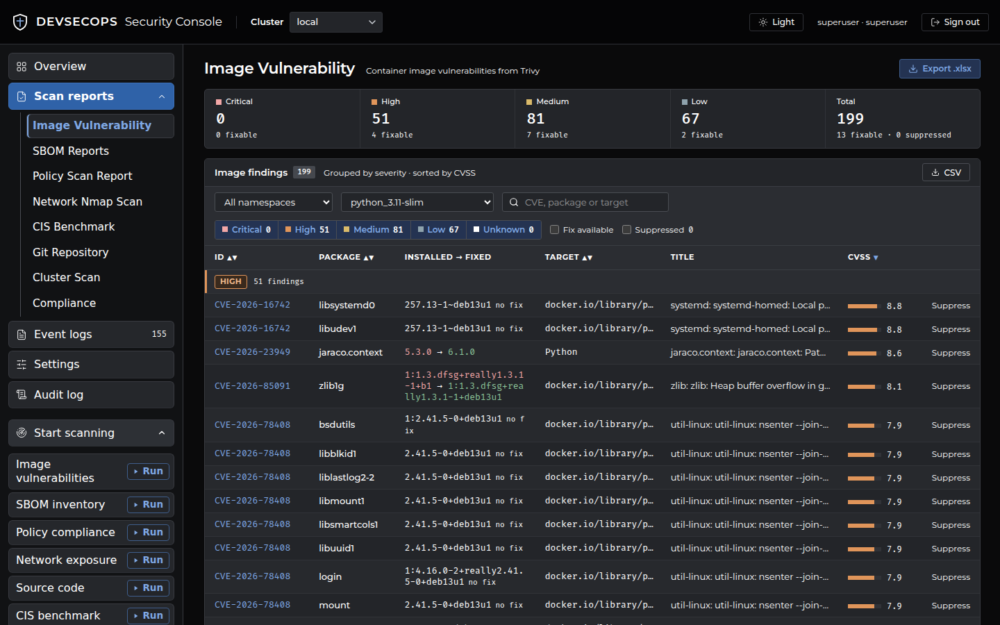
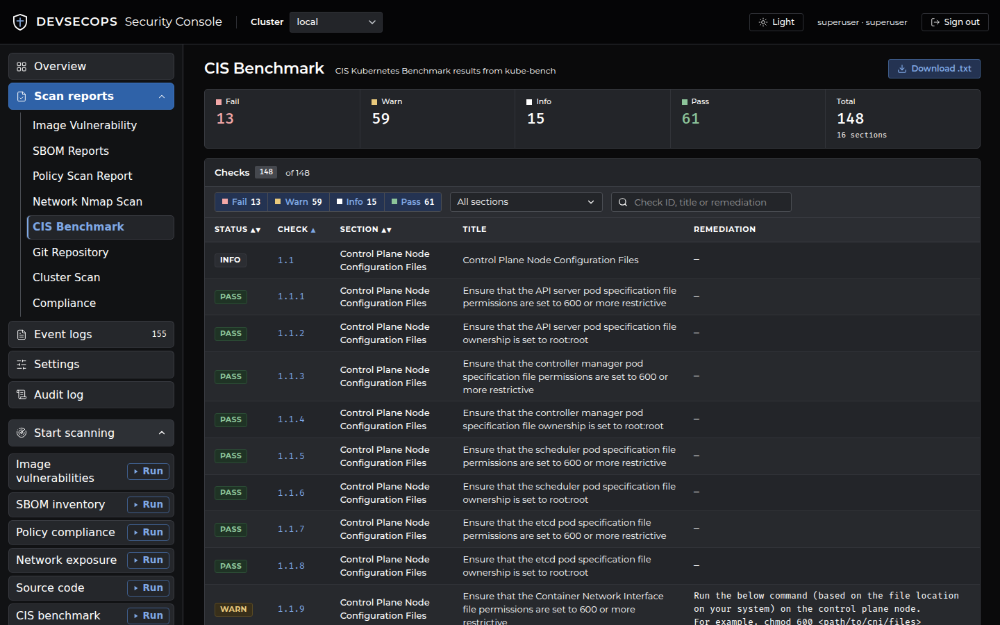
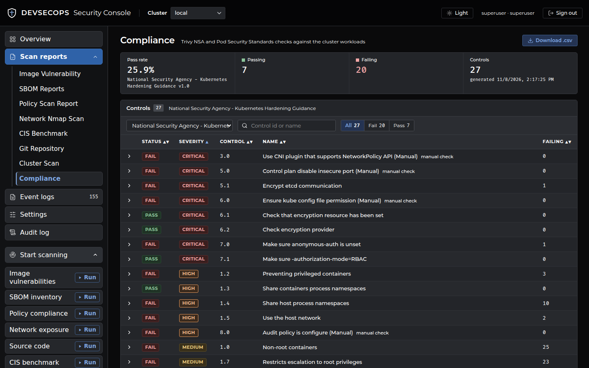
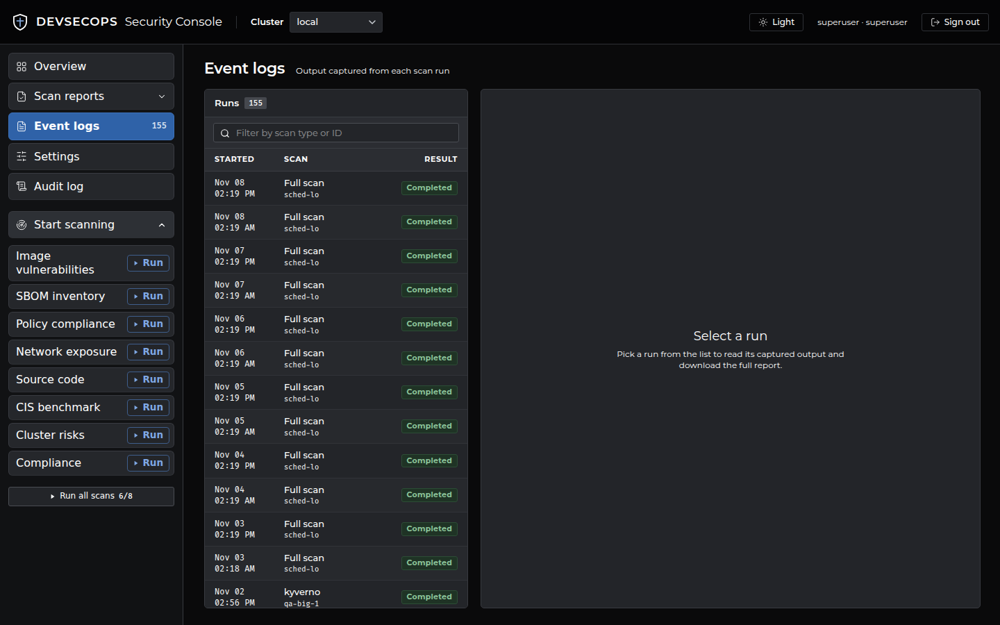
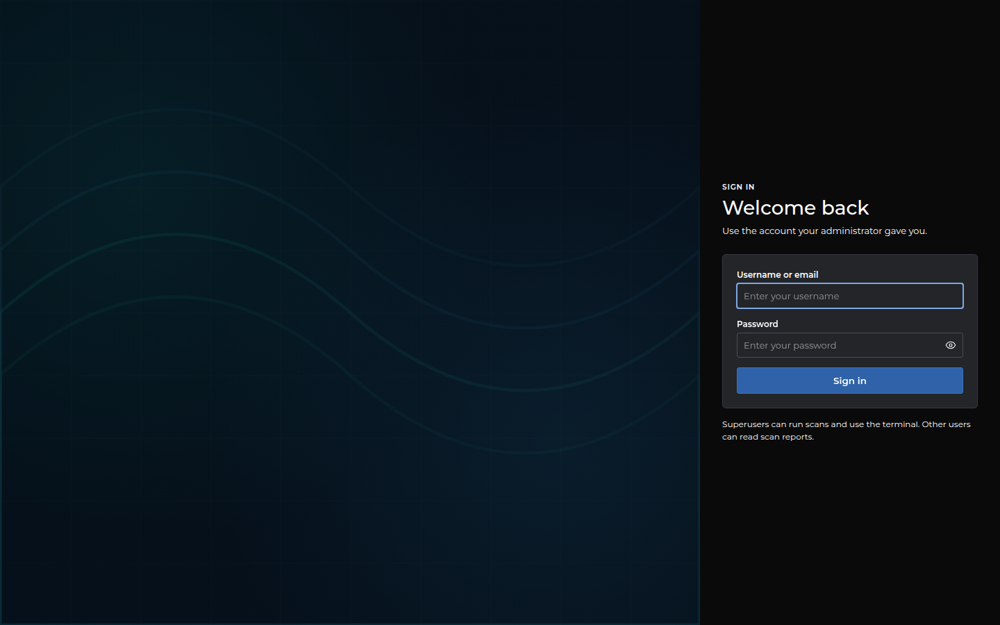

# DevSecOps Security Dashboard

A web dashboard that runs security scans against Kubernetes clusters, container images and Git repositories, and shows the results in one place. It wraps [Trivy](https://trivy.dev), [kube-bench](https://github.com/aquasecurity/kube-bench), [Kyverno](https://kyverno.io) and Nmap behind a React UI and a FastAPI backend, and ships as a single container.



## Features

- **Eight scanners** from one sidebar, or all at once with *Run all scans*: image vulnerabilities, SBOM, policy compliance (Kyverno), network exposure (Nmap), source code (Trivy repo), CIS benchmark (kube-bench), cluster risks and compliance (NSA / Pod Security Standards).
- **Multiple clusters.** Scan the cluster the dashboard runs in (`local`) and any cluster you register with a kubeconfig. Switch with the *Cluster* selector in the header.
- **Scheduled scans.** Daily scan times per cluster (UTC, up to 6 per cluster).
- **Overview page.** Security score, open findings by severity, new vs resolved findings and pass rates, with 7/30/90 day trends built from a snapshot saved after every scan.
- **Report viewers** with filtering, search, sorting and export (CSV / XLSX / TXT).
- **Suppressions** to hide accepted findings.
- **Live scan output** over WebSocket, plus a stored log for every run (*Event logs*).
- **Roles and audit log.** Two roles (`superuser`, `user`) and an audit trail of logins, scans and settings changes.
- **Optional web terminal** with `kubectl` (off by default).

## Screenshots

| | |
|---|---|
|  |  |
| Image vulnerabilities (Trivy) | CIS benchmark (kube-bench) |
|  |  |
| Compliance (NSA / Pod Security Standards) | Event logs |

## Quick start

### 1. Run on Kubernetes (recommended)

Requirements: `docker`, `kubectl` access to the target cluster, a registry you can push to, and an nginx ingress controller.

```bash
# Edit REPO and INGRESS_IP at the top of the script first
./build_and_deploy.sh        # add -y to skip the confirmation prompt
```

The script builds and pushes the image, applies the manifests in [security-dashboard/k8s/](security-dashboard/k8s/), and **creates the auth Secret only if it does not exist**. On first run it prints the generated `superuser` and `user` passwords once. Save them.

The dashboard is then available at:

- the ingress host `http://security-dashboard.<INGRESS_IP>.nip.io`, and
- NodePort `30095` on any node.

To apply the manifests by hand instead:

```bash
cd security-dashboard/k8s
kubectl apply -f dashboard.yaml
kubectl apply -f dashboard-rbac.yaml
kubectl apply -f dashboard-admission-policy.yaml
# Create the auth Secret yourself (it is not in dashboard.yaml):
kubectl create secret generic security-dashboard-auth -n security-ops \
  --from-literal=SUPERUSER_PASSWORD='<password>' \
  --from-literal=USER_PASSWORD='<password>' \
  --from-literal=AUTH_SECRET="$(openssl rand -hex 32)"
```

Update the `image:` and `DASHBOARD_IMAGE` values in `dashboard.yaml` to your own registry, and the ingress host to match your cluster. See [dashboard-secret.example.yaml](security-dashboard/k8s/dashboard-secret.example.yaml) for the Secret shape.

### 2. Run with Docker

```bash
docker build -t security-dashboard:latest .
docker run -d -p 8000:8000 \
  -e SUPERUSER_PASSWORD='<password>' \
  -e USER_PASSWORD='<password>' \
  -e AUTH_SECRET="$(openssl rand -hex 32)" \
  -e KUBECONFIG=/kube/config -v ~/.kube/config:/kube/config:ro \
  security-dashboard:latest
```

Open http://localhost:8000. The container runs as UID 10001, so the kubeconfig must be readable by that user (`chmod 644`, or use a copy).

### 3. Run locally for development

Requirements: Python 3.12, Node 18+, and `trivy`, `kubectl`, `nmap` on your `PATH` if you want to run scans.

```bash
export SUPERUSER_PASSWORD=admin USER_PASSWORD=viewer AUTH_SECRET=dev-secret-change-me
./start-app.sh
# UI:  http://localhost:5173
# API: http://localhost:8000   (Swagger at /docs when ENABLE_DOCS=true)
```

Scripts are run from `APP_HOME` and write results under `new/` relative to it, so scan from a scratch directory if you do not want results in your checkout.

## Using the dashboard

### 1. Sign in



| Role | Can do |
|---|---|
| `superuser` | Everything: run scans, change settings, view the audit log, use the terminal (if enabled). |
| `user` | Read-only: Overview and Scan reports. |

Tokens last 12 hours. Login attempts are rate limited.

### 2. Configure Settings (superuser)

**Container registries.** Add credentials for private registries. Trivy logs in to each registry before scanning images. Without them, image scans of private images fail.

**Clusters.** `local` is the cluster the dashboard pod runs in, using its ServiceAccount. To scan another cluster, add a name and paste its kubeconfig (optionally a context). The kubeconfig is stored on the server and never returned by the API. Use *Test* to check reachability. Removing a cluster keeps its scan data unless you choose to delete it.

**Schedule.** Pick up to 6 daily UTC times per cluster. Each run starts the *Full scan* list. Trivy scans never overlap: a run that has to wait starts as soon as the running scan finishes.

**Git repositories.** Needed for the *Source code* scan. Enter a username, a personal access token and one repository URL per line. The token is write-only.

**Full scan.** Choose which scanners *Run all scans* and scheduled runs include.

**Suppressions.** Findings you have accepted. Suppressed findings are excluded from counts and can be shown with the *Suppressed* filter.

### 3. Run a scan (superuser)

Use **Start scanning** in the sidebar. Scanners that need setup show **Set up** and link to the right settings page.

| Scanner | Tool | Needs |
|---|---|---|
| Image vulnerabilities | `trivy image` | Registry credentials for private images |
| SBOM inventory | `trivy sbom` | Same as above |
| Policy compliance | Kyverno policy reports | Kyverno installed in the cluster |
| Network exposure | `nmap` | Permission to run a temporary pod in the target cluster |
| Source code | `trivy repo` | Git repositories configured |
| CIS benchmark | kube-bench Job | Local cluster only |
| Cluster risks | `trivy k8s` | Cluster access |
| Compliance | `trivy k8s --compliance` | Cluster access |

Output streams live while the scan runs. Use the stop button to cancel. Image scans pull images from the registry (`--image-src remote`) and the log ends with `scanned=N skipped=M`.

### 4. Read the results

- **Overview** shows the score, severity totals, trends and the latest result per scanner. Use *Export summary* to download it.
- **Scan reports** has one view per scanner. Filter by severity, namespace or target, search by CVE or package, and export.
- **Event logs** lists every run with its captured output and a download link.
- **Audit log** (superuser) shows the 500 most recent events.


## Configuration

Environment variables read by the backend:

| Variable | Default | Purpose |
|---|---|---|
| `SUPERUSER_PASSWORD`, `USER_PASSWORD` | none (login fails if unset) | Account passwords. Plain text, or `pbkdf2_sha256$<iter>$<salt_b64>$<hash_b64>`. |
| `AUTH_SECRET` | random per start | Signs login tokens. Set it, or every restart logs everyone out. |
| `ENABLE_TERMINAL` | `false` | Enables the interactive `kubectl` terminal tab. Commands are audit logged. |
| `ENABLE_DOCS` | `false` | Serves Swagger UI at `/docs`. |
| `STATE_DIR` | `.` | Database, registry/Git credentials and cluster data. Keep it on a persistent volume. |
| `NEW_DIR` | `/app/new` | Scan results for the `local` cluster. |
| `APP_HOME` | `/app` | Where the scan scripts live and run from. |
| `STATIC_DIR` | `/app/static` | Built React app served by FastAPI. |
| `DASHBOARD_IMAGE` | see `kubebench_job.py` | Image used for the kube-bench Job. Set it to your own image. |
| `LOGIN_RATE_MAX`, `LOGIN_RATE_WINDOW` | `10`, `300` | Login attempts allowed per window (seconds). |

Tool versions are Docker build args: `TRIVY_VERSION`, `KUBE_BENCH_VERSION`, `KYVERNO_VERSION`.

## Security model

- The pod runs as UID 10001 with all capabilities dropped, `seccomp: RuntimeDefault` and a read-only root filesystem.
- The ClusterRole is read-only and has no access to Secrets. A namespaced Role in `security-ops` allows Jobs, pods and pod logs.
- kube-bench runs as a short-lived Job with `hostPID` and read-only host paths. [dashboard-admission-policy.yaml](security-dashboard/k8s/dashboard-admission-policy.yaml) limits the dashboard ServiceAccount to creating only that fixed Job.
- API routes `/api/scans`, `/api/settings`, `/api/terminal` and `/api/audit` require the `superuser` role.
- Registry and Git credentials are stored in `STATE_DIR` on the server. Treat that volume as sensitive.
- Put the dashboard behind TLS if you expose it beyond a trusted network. The default ingress is plain HTTP.

## Project layout

```
.
├── Dockerfile                  # Multi-stage build: React app + FastAPI + scan tools
├── build_and_deploy.sh         # Build, push, apply manifests, create Secret
├── start-app.sh                # Local dev: backend :8000 + frontend :5173
├── [1-8]_run_*.sh              # One script per scanner, run by the backend
└── security-dashboard/
    ├── backend/                # FastAPI: routers/, services/, models.py, auth.py, db.py
    ├── frontend/               # React + Vite + Tailwind
    └── k8s/                    # Deployment, RBAC, admission policy, Secret example
```

## API

The API is under `/api` and uses `Authorization: Bearer <token>` from `POST /api/login`. Set `ENABLE_DOCS=true` for the full OpenAPI reference at `/docs`.

```bash
TOKEN=$(curl -s localhost:8000/api/login -H 'content-type: application/json' \
  -d '{"username":"superuser","password":"<password>"}' | jq -r .token)

# Start a scan, then follow it on WS /api/scans/ws/{scan_id}
curl -s localhost:8000/api/scans/start -H "Authorization: Bearer $TOKEN" \
  -H 'content-type: application/json' -d '{"scan_type":"trivy-cluster","cluster":"local"}'
```

Scan types: `trivy-image`, `trivy-sbom`, `trivy-cluster`, `trivy-compliance`, `trivy-repo`, `kube-bench`, `kyverno`, `nmap`, `all`.

## Troubleshooting

- **Everyone gets logged out after a restart.** `AUTH_SECRET` is not set.
- **Cannot log in.** `SUPERUSER_PASSWORD` or `USER_PASSWORD` is unset or empty.
- **A scanner shows "Set up".** Add the missing registry or Git credentials under Settings.
- **Terminal tab is missing.** Set `ENABLE_TERMINAL=true`.
- **CIS benchmark or Source code is missing for a cluster.** These are available for the `local` cluster only.
- **Settings are lost on redeploy.** `STATE_DIR` is not on a persistent volume.
